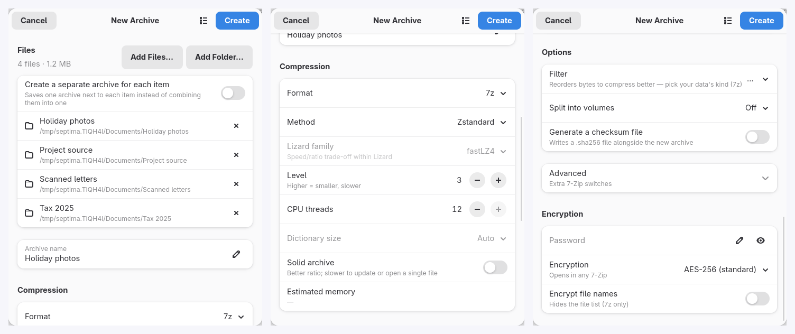
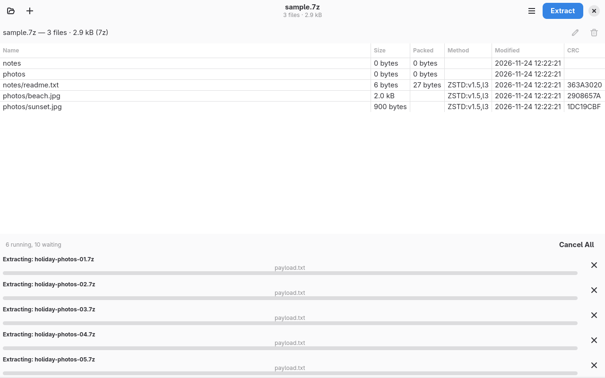
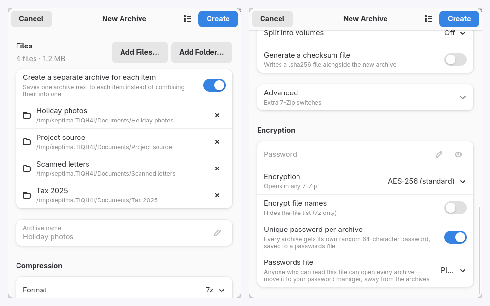

<p align="center">
  
</p>

<h1 align="center">Septima</h1>

<p align="center"><strong>A GNOME app for 7-Zip ZS: modern compression inside real <code>.7z</code> files, with every setting as a control.</strong></p>

Septima is a GTK4 / libadwaita front-end for
[7-Zip ZS](https://github.com/mcmilk/7-Zip-zstd) on Linux. It creates, opens
and extracts archives using **Zstandard, Brotli, Fast-LZMA2** and the rest of
what 7-Zip ZS offers, and puts the tuning that normally lives in command-line
switches into an ordinary dialog.

It is an archive tool, not a file manager. It runs as a sandboxed Flatpak with
its own copy of `7zz`, and reaches your files only through the desktop's file
choosers.

<p align="center">
  
</p>

**Current version: 0.7.0** · [What's new](CHANGELOG.md) ·
[Website](https://superuser-miguel.github.io/septima/), with a command builder
you can try in the browser

## Install

From the project's signed Flatpak repo. New releases arrive with
`flatpak update`:

```sh
flatpak install --user https://superuser-miguel.github.io/septima-repo/septima.flatpakref
flatpak run io.github.superuser_miguel.Septima
```

Or download `Septima.flatpak` from the
[latest release](https://github.com/superuser-miguel/septima/releases/latest)
and run `flatpak install --user ./Septima.flatpak`. The single file has no
update path; you reinstall to move to a newer version.

## What it does

### Create

- **7z, zip and tar**, plus compressed tarballs (`.tar.zst`, `.tar.xz`,
  `.tar.br` and more) in one step, and single-file streams such as a bare
  `.zst` or `.br`.
- **Every method 7-Zip ZS has**: LZMA2, LZMA, PPMd, Zstandard, Brotli,
  Fast-LZMA2, LZ4, LZ5, Lizard, BZip2, Deflate, Deflate64, XZ and Store.
- **Tuning as controls**: level (the range follows the method), dictionary
  size, solid mode, CPU threads, and a memory estimate before you start.
- **Filters from a menu**: x86, ARM64, ARM, PowerPC, SPARC, RISC-V and Delta.
- **Split into volumes**, write a `.sha256` next to the archive, and save any
  setup as a named preset.
- **An Advanced field** that passes any other 7-Zip switch straight through.

### Open and extract

- **Browse anything `7zz` reads**: 7z, zip, tar, xz, gzip, bzip2, zstd, rar and
  more. A `.tar.zst` shows its files, not the tar inside it.
- **Extract with live progress and cancel.** Drag entries out of the window to
  extract just those.
- **Nothing is replaced without asking.** When names clash, choose Keep both
  (the default), Skip or Replace.
- **Edit in place**: delete or rename entries, and test an archive's integrity.

### Batches

<p align="center">
  
</p>

- **Extract many archives at once**, each into its own folder: *Extract Several
  Archives* in the menu, Ctrl+Shift+E, or drop them on the window.
- **Create one archive per item** from a list of files and folders.
- **A few run at a time.** Septima works on half as many archives as your CPU
  has threads (at least 2, at most 8). The rest wait their turn, and you can
  cancel one or all of them.
- **One summary at the end**, one list of anything that failed, and one
  password question for the encrypted ones.

### Encryption

<p align="center">
  
</p>

- **AES-256 for 7z and zip**, with encrypted file names for 7z. Zip uses AES-256
  instead of its weak ZipCrypto default.
- **Four newer methods for 7z** from 7-Zip ZS 26.05: XChaCha20-Poly1305 and
  three AES/XChaCha20 cascades. They open in 7-Zip ZS 26.05 or newer, not in
  stock 7-Zip, and the dialog says so. AES-256 stays the default.
- **A password per archive.** In batch mode, every archive can get its own
  random 64-character password, written to a **passwords file** you keep
  wherever you keep secrets. Open that file in Septima later and it extracts
  the whole set. The file can be protected with a password of its own
  (standard OpenPGP, so any `gpg` opens it).
  [How it works](https://superuser-miguel.github.io/septima/blog/2026-08-16-batch-encrypt-passwords-file.html).

### Tools

- **Checksums**: 13 kinds, including SHA-256, SHA3, BLAKE3 and XXH64, with
  copy and verify against a checksum file.
- **Keyboard shortcuts** for everything common. Ctrl+? lists them.
- **What Septima Can Do** (F1) lists every format, method and `7zz` switch the
  app uses. A test keeps that list in step with the code.

## Switches without a control

Anything typed into the create dialog's **Advanced** field is passed to
`7zz a` after the dialog's own options. A few that people reach for:

| Switch | What it does |
|---|---|
| `-snl` | Store symbolic links as links. Without it, 7-Zip stores a copy of what each link points to |
| `-xr!.git` | Leave out everything named `.git` (works for any name or pattern) |
| `-mfb=273` | Word size for LZMA and LZMA2: a little smaller, a little slower |
| `-ms=100m` | Solid blocks of 100 MB, instead of one block for everything |
| `-mtc=on` | Store creation times |

The field splits on spaces, so a switch that contains a space won't work.

## What's next

- **0.7.1**: a testing and code-review release, with no new features.
- **Later**: see the roadmap on the [website](https://superuser-miguel.github.io/septima/#roadmap).

Past releases are in the [changelog](CHANGELOG.md).

## Build from source

Septima builds and runs entirely inside the GNOME Flatpak sandbox.

```sh
flatpak install flathub org.gnome.Platform//50 org.gnome.Sdk//50 \
    org.freedesktop.Sdk.Extension.rust-stable//25.08
flatpak-builder --user --install --force-clean build-dir \
    build-aux/io.github.superuser_miguel.Septima.Devel.json
flatpak run io.github.superuser_miguel.Septima.Devel
```

For host development (needs `gtk4-devel`, `libadwaita-devel`, `blueprint-compiler`,
Meson, and `7zz` on `PATH`):

```sh
meson setup builddir -Dprofile=development
meson compile -C builddir
```

## Acknowledgements

- **[7-Zip ZS](https://github.com/mcmilk/7-Zip-zstd)** by Tino Reichardt — the
  `7zz` binary Septima bundles and drives, which extends **7-Zip** by Igor Pavlov
  with Zstandard, Brotli, LZ4/LZ5, Lizard and Fast-LZMA2. Septima is *not* a fork
  of it; it is bundled unmodified as a separate Flatpak module.
- Built with **[gtk4-rs](https://gtk-rs.org/)**, **libadwaita**,
  **[Blueprint](https://gnome.pages.gitlab.gnome.org/blueprint-compiler/)**, and
  **Meson** — following the conventions of Amberol, Fractal and friends.

## License

Septima is **GPL-3.0-or-later**. The bundled 7-Zip ZS remains its own
LGPL-2.1-or-later / BSD-licensed work, built as a separate module.
